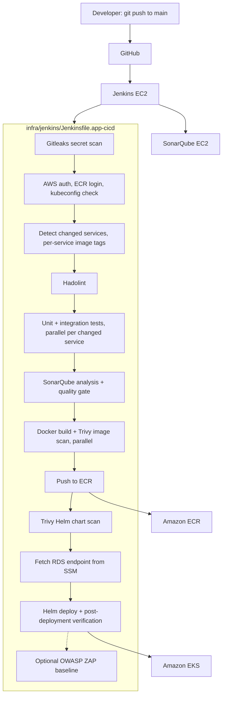
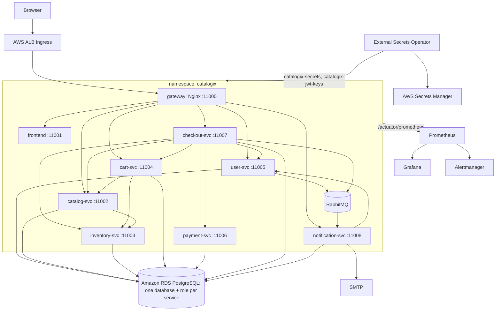

# Catalogix

An e-commerce application made of seven Spring Boot services, a React front end and an Nginx gateway, plus the delivery platform around it: Terraform, Ansible, Jenkins, Helm on Amazon EKS, security scanning and monitoring.

The application is deliberately modest in business logic. It is big enough to need real delivery engineering (several services, a database, a message broker, service-to-service authentication) and small enough that the platform stays the focus.

**Terraform · Ansible · Jenkins · Docker · Amazon EKS · Helm · SonarQube · Trivy · Gitleaks · External Secrets Operator · Prometheus · Grafana**

> **Status.** The code and configuration were reviewed and cross-checked, and the front-end and Python test suites were run. A full `mvn verify`, `helm template`, `terraform plan` and a real pipeline run are what prove the whole thing, and results are not recorded in this repository yet. See [Verification](#verification) before relying on any claim here.

---

## Contents

- [What this project demonstrates](#what-this-project-demonstrates)
- [Tech stack](#tech-stack)
- [Quick start (local, Docker Compose)](#quick-start-local-docker-compose)
- [Architecture](#architecture)
- [Repository layout](#repository-layout)
- [Running on AWS](#running-on-aws)
- [Security controls](#security-controls)
- [Verification](#verification)
- [Design decisions and trade-offs](#design-decisions-and-trade-offs)
- [Known limitations](#known-limitations)

---

## What this project demonstrates

- **CI/CD with security gates.** One Jenkins pipeline scans for secrets, lints Dockerfiles, runs tests only for changed services, enforces a SonarQube quality gate, builds and scans every image with Trivy, scans the Helm chart, deploys with Helm to EKS and checks the rollout.
- **Infrastructure as code in layers.** Remote state, network plus CI servers, and the platform (EKS, RDS, ECR, ALB controller, External Secrets) are three separate Terraform roots with separate lifecycles. The platform can be destroyed and rebuilt without touching the network.
- **Secrets nobody handles.** Per-service database passwords and the JWT signing keys are generated by Terraform, stored in AWS Secrets Manager and synced into the cluster by External Secrets Operator. Passwords a person has to choose (RDS master, RabbitMQ, admin, Grafana) are set once with a small CLI into their own Secrets Manager secret. They are not Terraform variables and not Jenkins credentials (the RDS master password is read by Terraform and therefore still ends up in state).
- **Database per service, the same everywhere.** One database and one login role per service, created by an init script on Docker Compose, by a Helm template on local Kubernetes and by a Terraform module on RDS.
- **Hardened Kubernetes workloads.** Non-root, read-only containers with all capabilities dropped, startup/readiness/liveness probes, autoscaling, PodDisruptionBudgets, graceful shutdown, resource limits, a default-deny NetworkPolicy with allow rules that follow the real call graph, and an ALB ingress.
- **Repeatable servers.** Jenkins and SonarQube are never configured by hand. Ansible provisions them from a dynamic EC2 inventory, and Jenkins Configuration as Code creates the admin user, credentials and both pipeline jobs on first boot.
- **A bootstrap CLI.** A stdlib-only installer puts the tools on a bare Linux machine, and `scripts/python/bootstrap.py` drives Terraform and Ansible with dependency checks, AWS credential checks, "skip apply when nothing changed" and Ansible Vault handling.
- **Observability with alerts.** Prometheus, Grafana and Alertmanager with service, JVM, RabbitMQ and checkout-outbox metrics and eight alert rules.

---

## Tech stack

| Area | Tools |
|---|---|
| Cloud | AWS: EKS, EC2, RDS, ECR, ALB, Secrets Manager, SSM Parameter Store, IAM, S3, KMS |
| Infrastructure as code | Terraform 1.12 or newer, S3 remote state |
| Server configuration | Ansible (dynamic EC2 inventory, roles, Ansible Vault) |
| CI/CD | Jenkins on EC2, JCasC, a shared library (`vars/`) |
| Containers and orchestration | Docker (multi-stage builds, distroless Java images), Kubernetes 1.36 on EKS, Helm |
| Quality and security | SonarQube, Gitleaks, Hadolint, Trivy (images, Helm chart, Terraform), optional OWASP ZAP |
| Secrets | AWS Secrets Manager, External Secrets Operator |
| Monitoring | kube-prometheus-stack 82.6.0 (Prometheus, Grafana, Alertmanager) plus the `infra/helm/monitoring` chart |
| Backend | Java 21, Spring Boot 4.1, Flyway, resilience4j, Maven multi-module |
| Messaging | RabbitMQ |
| Database | PostgreSQL 18 (Amazon RDS on AWS, a container locally) |
| Frontend | React 19, Vite 8, Tailwind CSS 4, Radix UI, served by Nginx |
| Tooling | Python 3 (stdlib installer and bootstrap CLI), one small shell script that installs Python |

---

## Quick start (local, Docker Compose)

You need Docker (with Compose), `openssl` and `python3`. The full stack needs roughly 6 GB of RAM and 4 CPUs.

```bash
cp .env.example .env                  # review the local passwords in it
bash scripts/generate-local-jwt-keys.sh   # creates the user key pair and the internal key pair in .env
docker compose up --build
```

| URL | What |
|---|---|
| http://localhost:11000 | The application (only the gateway is published) |
| http://localhost:8025 | Mailpit: verification and password-reset emails arrive here |
| http://localhost:25672 | RabbitMQ management UI |
| localhost:5432 | PostgreSQL |

Local admin login: `admin@catalogix.local` / `AdminAdminAdmin`.

Notes:
- `generate-local-jwt-keys.sh` replaces both key pairs each time. Run it once per environment; rerunning logs everyone out.
- `POSTGRES_PASSWORD` and `SERVICE_DB_PASSWORD` are read only when the Postgres volume is first created. After changing them, or after pulling a schema change, run `docker compose down -v`.
- Java containers are distroless and have no healthcheck, so Compose only orders their start. Calls made before a dependency is ready fail fast through the circuit breakers.
- To work on one service: `docker compose up postgres rabbitmq payment-svc`.

Build and test from the repository root, with no `cd`:

```bash
mvn verify          # all backend modules (integration tests need Docker for Testcontainers)
npm ci              # frontend dependencies (the root package.json forwards to app/frontend)
npm test            # frontend tests (vitest)
npm run build       # production bundle in app/frontend/build
npm start           # Vite dev server
```

Local Kubernetes (Docker Desktop, kind, minikube) is covered in [infra/helm/catalogix-hc/README.md](infra/helm/catalogix-hc/README.md).

---

## Architecture

### Delivery flow



### Runtime architecture



The arrows between services are exactly the allow rules in the Helm `NetworkPolicy`. `inventory-svc` and `payment-svc` are internal only: the gateway has no route to them.

### Services

| Service | Port | Responsibility |
|---|---|---|
| `gateway` | 11000 | Nginx routing, rate limiting, the single entry point |
| `frontend` | 11001 | React single-page application served by Nginx |
| `catalog-svc` | 11002 | Products, search, ownership, moderation, live stock composition |
| `inventory-svc` | 11003 | Stock quantities, idempotent reserve and release |
| `cart-svc` | 11004 | Persistent per-user cart and the cart-to-checkout handoff |
| `user-svc` | 11005 | Registration, login, JWT and refresh sessions, password reset, email verification, profiles, addresses, seller requests, admin user management |
| `payment-svc` | 11006 | Mock CARD / UPI / COD payments, idempotency, refunds |
| `checkout-svc` | 11007 | Orders, order state machine, payment orchestration, stock-compensation outbox, order-event outbox |
| `notification-svc` | 11008 | RabbitMQ consumer, email delivery, notification log |
| `security-common` | none | Shared library, not a service: JWT validation, rate limiting, CORS |

How the application works (order flow, outbox, tokens, failure behaviour) is in [docs/app-guide.md](docs/app-guide.md).

### Kubernetes namespaces

| Namespace | Workloads | Managed by |
|---|---|---|
| `catalogix` | gateway, frontend, the seven backend services, RabbitMQ | Jenkins `app-cicd`, Helm release `catalogix` |
| `monitoring` | Prometheus, Grafana, Alertmanager, ServiceMonitors, alert rules, dashboard | Jenkins `platform-infra`, Helm release `monitoring` |
| `external-secrets` | External Secrets Operator | Terraform (`eso` module) |

---

## Repository layout

```text
app/                    what runs
  backend/              security-common and the seven services (Maven modules)
  frontend/             React app and its Nginx image
  gateway/              Nginx gateway
  postgres-init/        per-service databases and roles for Docker Compose
infra/                  where it runs and how it gets there
  terraform/            backend-bootstrap, bootstrap-infra, platform-infra
  ansible/              playbook and roles that configure Jenkins and SonarQube
  helm/catalogix-hc/    the application chart
  helm/monitoring/      Prometheus/Grafana configuration, alert rules, dashboard
  jenkins/              Jenkinsfile.app-cicd, Jenkinsfile.platform-infra, Jenkinsfile.lint
scripts/                installers, bootstrap CLI, local scan helpers, key generation
docs/                   app-guide.md, github-webhook.md
vars/                   Jenkins shared library
docker-compose.yaml     the whole application locally
pom.xml, package.json   root entry points so mvn and npm commands run from here
sonar-project.properties, .trivyignore, .gitleaks.toml, .dockerignore   scanner and build settings
```

Each area has its own README:

| README | Covers |
|---|---|
| [app/README.md](app/README.md) | Services, ports, data, authentication, building and testing |
| [infra/README.md](infra/README.md) | How the infrastructure pieces fit together and the order to run them |
| [infra/terraform/README.md](infra/terraform/README.md) | The three layers, modules, secrets, state |
| [infra/ansible/README.md](infra/ansible/README.md) | Server provisioning and JCasC |
| [infra/jenkins/README.md](infra/jenkins/README.md) | The three pipelines, parameters and stages |
| [infra/helm/catalogix-hc/README.md](infra/helm/catalogix-hc/README.md) | Chart, values files, hardening, NetworkPolicy, local Kubernetes |
| [infra/helm/monitoring/README.md](infra/helm/monitoring/README.md) | Metrics, alerts, dashboard, access |
| [scripts/README.md](scripts/README.md) | Installer, bootstrap CLI, IP allowlist, local scans |
| [docs/app-guide.md](docs/app-guide.md) | A guided tour of the application |
| [docs/github-webhook.md](docs/github-webhook.md) | Triggering Jenkins from GitHub |

Some files stay at the repository root because the tool that reads them looks there: `vars/` (Jenkins loads a shared library from the repository root), `.dockerignore` (read from the build-context root), `.gitleaks.toml`, `.trivyignore`, `sonar-project.properties`, `pom.xml`, `package.json` and `docker-compose.yaml`. `docker-compose.yaml` stays because `docker compose up` from the root is the front door of the project and its build contexts and `.env` are relative to the root. Jenkins finds the pipelines through the `scriptPath` entries in `infra/ansible/roles/jenkins/templates/jcasc.yaml`.

---

## Running on AWS

Prerequisites: an AWS account (the default region is `ap-south-1`), an AWS CLI profile allowed to create the bootstrap resources (a scoped IAM user is better than AdministratorAccess, and its key should be deleted after bootstrap), and a Linux machine or WSL.

1. **Tools.** `bash scripts/bash/install-all.sh` installs Python if it is missing, then the AWS CLI, Terraform, Ansible, `jq` and `ssh-keygen`. Then `aws configure`.
2. **SSH key.** `bash scripts/bash/create-key-pair.sh`.
3. **Bootstrap.** `python3 scripts/python/bootstrap.py` creates the state bucket, the VPC and the two EC2 servers, configures them with Ansible, and asks for the operator-chosen passwords.
4. **Platform.** Run the Jenkins job `platform-infra` with `ACTION=Apply` (EKS, RDS, ECR, ALB controller, External Secrets, monitoring).
5. **Application.** Push to `main`, or run `app-cicd` for the chosen environment.
6. **Destroy.** Run `platform-infra` with `ACTION=Destroy` and `CONFIRM_DESTROY=true`, then `python3 scripts/python/destroy_infra.py` for the bootstrap layer. The S3 state bucket is kept on purpose.

Details and the reasons for the order are in [infra/README.md](infra/README.md).

---

## Security controls

| Control | Where | If it fails |
|---|---|---|
| Gitleaks secret scan | First stage of `app-cicd` | No code runs |
| Hadolint | Before the build | Build fails |
| SonarQube quality gate | After tests | Nothing is built or pushed |
| Trivy image scan (fixable HIGH and CRITICAL) | After each image build | The image is not pushed to ECR |
| Trivy scan of the Helm chart and of Terraform | Before deploy, and before `terraform plan` in `platform-infra` | Deploy or plan does not run |
| Non-root, read-only filesystem, capabilities dropped | Pod spec | The container cannot start or write |
| Default-deny NetworkPolicy plus per-service allow rules | Helm chart | A pod can only be reached by its real callers. Enforced on EKS through the VPC CNI add-on |
| Per-service database credentials | Terraform, Secrets Manager, External Secrets | One service cannot open another's database |
| No secrets in the pipeline | External Secrets | No Jenkins credential holds a database password or a JWT private key |
| User tokens signed only by `user-svc` | RS256, private key mounted only in `user-svc` | Other services can verify tokens but cannot mint them |
| Service-to-service tokens | One shared internal RS256 key, `iss`/`aud` checks, caller allowlists on internal endpoints | See the limitation below |
| EKS API endpoint restricted | `public_access_cidrs` | Reachable only from Jenkins and the allowlisted operator IPs |
| SSH and Jenkins UI restricted | Security groups driven by an IP allowlist | Reachable only from allowlisted IPs |

---

## Verification

What is covered by automated tests in this repository:

| Area | Command | Notes |
|---|---|---|
| Backend | `mvn verify` | Unit tests and Testcontainers integration tests. Needs Docker |
| Frontend | `npm test` | 66 tests (vitest) |
| Python tooling | `python3 -m unittest discover -s scripts/python/tests` | 59 tests (allowlist and credentials) |
| Helm image-tag contract | `scripts/ci/check-helm-image-tags.sh` | Needs `helm`; checks that every service's image tag really comes from the values the pipeline sets |
| Whole local gate | `python3 scripts/python/local_scans/devsecops_check.py --start-sonarqube` | Gitleaks, tests, SonarQube, Trivy, Compose smoke test |

What has not been run end to end, and therefore is not claimed as working:

| Check | Command | Result |
|---|---|---|
| Backend build on the current layout | `mvn verify` | not recorded |
| Chart renders | `helm template catalogix infra/helm/catalogix-hc -f infra/helm/catalogix-hc/values-dev.yaml` | not recorded |
| Terraform plan | `terraform plan` in `infra/terraform/platform-infra/env/dev` | not recorded |
| Container builds | `docker compose build` | not recorded |
| NetworkPolicy enforced on EKS | see [the chart README](infra/helm/catalogix-hc/README.md#testing-the-networkpolicy) | not recorded |
| Pipelines | one run each of `platform-infra` and `app-cicd` | not recorded |

When you run these, write the date and result in this table. A column of green results is worth more than any sentence above it.

---

## Design decisions and trade-offs

1. **Jenkins on EC2 instead of a managed CI service.** It reflects self-managed CI at product companies and forced a repeatable setup (Ansible and JCasC). *Trade-off:* the server must be patched and run.
2. **SonarQube on its own instance.** Analysis is memory-heavy and would compete with builds. *Trade-off:* a second server to pay for and manage.
3. **External Secrets instead of Jenkins credentials.** Nobody handles database passwords and secrets stay in sync with Secrets Manager. *Trade-off:* ESO is one more component. If it stops, existing secrets keep working until a pod restarts.
4. **Three Terraform roots.** The network changes rarely and the cluster can be rebuilt on its own. *Trade-off:* apply order is a convention, not enforced in code.
5. **Monitoring from the platform pipeline.** An application commit never restarts Prometheus. *Trade-off:* the monitoring stack has its own trigger.
6. **Per-service image tags.** Only changed services are rebuilt, and unchanged ones keep their live tag so their pods are not restarted. *Trade-off:* the previous tag is read back from the Helm release, so `FORCE_ALL_BUILDS` exists to reset it.
7. **Trivy ignores unfixed CVEs.** Blocking on findings with no patch gives no benefit. *Trade-off:* they are hidden from pipeline output. The documented, expiring `.trivyignore` is the compensating control.
8. **RabbitMQ for email.** Password-reset and order emails do not depend on SMTP being up at request time. *Trade-off:* a stateful broker to run.
9. **Database per service on one instance.** Role-level isolation without paying for seven RDS instances. *Trade-off:* it is not failure isolation.
10. **One shared internal signing key for service-to-service calls.** Seven private keys per environment are more to generate, store and explain than the threat justifies at this size. *Trade-off:* a compromised service could sign a token naming another service. The NetworkPolicy and the caller allowlists narrow what that can reach; per-service keys or mTLS would close it.
11. **Python for tooling, shell only to install Python.** A bare VM has a shell but not always Python. One short script installs Python, and everything else is Python that behaves the same on apt, dnf, yum and zypper systems. *Trade-off:* the scripts need Python 3.9 or newer.
12. **No further splitting.** No service discovery, config server or BFF. Kubernetes DNS and the gateway are enough at this scale.

---

## Known limitations

| Limitation | Note |
|---|---|
| Internal calls share one signing key | Every service holds the same internal private key, so a compromised service could sign as another. The NetworkPolicy narrows who can connect; per-service keys or mTLS would close the gap |
| NetworkPolicy covers inbound traffic only | Outbound traffic is open. Policies are silently ignored on a cluster whose network plugin does not enforce them (Docker Desktop, for example) |
| JWT keys cannot be rotated without logging everyone out | Replacing the keys invalidates every live token. Graceful rotation would need a second accepted public key |
| Private keys are in Terraform state | `tls_private_key` stores them there. Keep the state bucket encrypted, private and tightly permissioned (it is encrypted and blocks public access) |
| Single NAT gateway | `nat_gateway_count` defaults to 1. Use one per availability zone for production |
| HTTP unless `INGRESS_HOST` and `TLS_CERT_ARN` are supplied | Enable HTTPS for anything real |
| Dev conveniences | `skip_final_snapshot`, ECR `force_delete` and a zero Secrets Manager recovery window are not environment-aware |
| RabbitMQ runs one replica | Quorum queues need at least three nodes for real high availability |
| Only `dev` is maintained and exercised. `staging` (Terraform `env/staging`, `values-staging.yaml`) is illustrative | It shows the multi-environment pattern and has never been deployed. Expect gaps (for example no seeded admin account); `prod` does not exist |
| Order emails are delivered at least once | If RabbitMQ confirms a message but the outbox row cannot be marked `PUBLISHED`, the relay sends it again and a customer may get a duplicate email. De-duplicating on message id in `notification-svc` would fix it |
| No tracing or log aggregation | Logs are container stdout and stderr (`kubectl logs`, `docker logs`) |
| Alerts go to email only, and only `critical` ones | One channel is enough to prove the chain |
| `Jenkinsfile.lint` is not wired to a job | JCasC creates only `platform-infra` and `app-cicd`. Add a job or create one by hand to use it |
