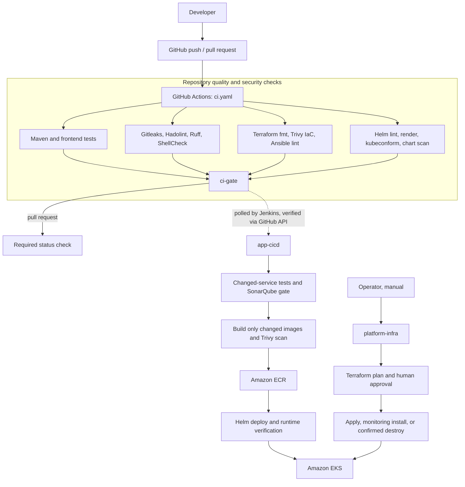
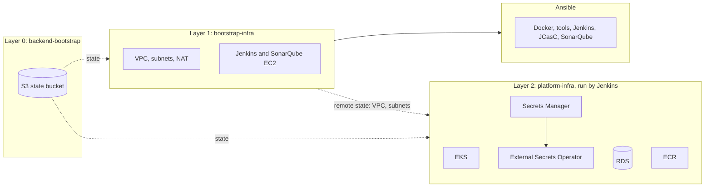
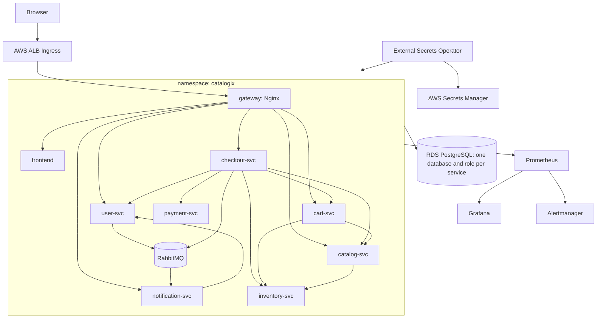

# Catalogix: a DevSecOps delivery platform on AWS

[](https://github.com/imshubhamkaushik/aws-cicd-devsecops/actions/workflows/ci.yaml)

This repository is a complete delivery pipeline: infrastructure as code, self-configuring CI servers, a security-gated build, GitOps-style secrets handling, a hardened Kubernetes deployment and monitoring with alerts. The thing being delivered is **Catalogix**, a small e-commerce system (seven Spring Boot services, a React front end, an Nginx gateway). It exists so the platform has a realistic workload: several services, a database per service, a message broker and service-to-service authentication.

**Terraform · Ansible · Jenkins · Docker · Amazon EKS · Helm · SonarQube · Trivy · Gitleaks · Hadolint · External Secrets Operator · Prometheus · Grafana**

> **Want to run it?** Start with [docs/RUNBOOK.md](docs/RUNBOOK.md). It takes you from an empty AWS account to a deployed, monitored application and back to a clean account.

---

## Contents

- [What this project demonstrates](#what-this-project-demonstrates)
- [Architecture](#architecture)
- [Tech stack](#tech-stack)
- [Repository layout](#repository-layout)
- [Quick start](#quick-start)
- [Security controls](#security-controls)
- [Cost and clean-up](#cost-and-clean-up)
- [Verification status](#verification-status)
- [Design decisions and trade-offs](#design-decisions-and-trade-offs)
- [Known limitations](#known-limitations)

---

## What this project demonstrates

| Area | What is in the repository |
|---|---|
| **Layered infrastructure as code** | Three Terraform roots with separate state and lifecycles: remote-state bucket, network plus CI servers, and the platform (EKS, RDS, ECR, ALB controller, External Secrets). The platform can be destroyed and rebuilt without touching the network. |
| **Repeatable CI servers** | Jenkins and SonarQube are never configured by hand. Ansible provisions them from a dynamic EC2 inventory (vault-encrypted secrets), and Jenkins Configuration as Code defines the credentials, tools, shared library and both jobs. |
| **A CI gate in GitHub Actions, a deploy pipeline in Jenkins** | `.github/workflows/ci.yaml` runs the repository checks (tests, lint, IaC, chart and secret scans) on every push and pull request and ends in one aggregate check, `ci-gate`. Jenkins `app-cicd` polls `main`, verifies through the GitHub API that `ci-gate` passed for the exact commit, then tests changed services, runs SonarQube, scans new images, publishes to ECR and deploys with Helm. `platform-infra` is manual and approval-controlled. |
| **Change-aware pipelines** | `app-cicd` tests and rebuilds only the services that changed, keeps unchanged image tags so their pods are not restarted, then scans, pushes and deploys. |
| **Shift-left and runtime security** | Gitleaks, Hadolint, Trivy (IaC, chart, images), SonarQube quality gate, distroless non-root images, read-only root filesystems, default-deny NetworkPolicy, optional OWASP ZAP baseline. |
| **Secrets without Jenkins in the loop** | Operator-chosen passwords go to AWS Secrets Manager through a validating CLI. Terraform generates per-service database credentials and JWT keys. External Secrets Operator syncs them into the cluster. No application secret is a pipeline parameter. |
| **Production-style Kubernetes** | Helm chart with probes, autoscaling, PodDisruptionBudgets, graceful shutdown, resource limits, per-service database roles and an ALB ingress. |
| **Observability with alerts** | kube-prometheus-stack plus a Catalogix chart: ServiceMonitors, eight alert rules, a Grafana dashboard and email routing for critical alerts. |
| **Operator tooling** | A stdlib-only Python toolchain installs the prerequisites, bootstraps AWS, manages credentials and the IP allowlist, and runs the same scans locally that Jenkins runs. It has its own unit tests. |
| **Multi-environment pattern** | `dev` is the maintained environment. A `staging` root and values file show how a second environment is added; it is illustrative and has never been deployed. |

---

## Architecture

### Delivery flow



The checks that need nothing from AWS run in GitHub Actions, which also means they run without any inbound connection to Jenkins. Jenkins is reachable only from operator IPs, so it pulls rather than being pushed to: it polls `main` and asks GitHub whether `ci-gate` passed for the commit it is about to deploy. Everything that needs AWS or the private network (SonarQube, image build and scan, ECR, Helm, `terraform plan` on live state) stays in Jenkins. Infrastructure changes are never applied by an ordinary push, so a code change cannot create or destroy cloud resources. Details: [docs/ci-gate.md](docs/ci-gate.md).

### Infrastructure layers



| Layer | Created by | Lifetime |
|---|---|---|
| State bucket | `infra/terraform/backend-bootstrap` | Once per account and region. Never destroyed by the scripts |
| Network and CI servers | `infra/terraform/bootstrap-infra` | Applied once and left running |
| Server configuration | `infra/ansible` | Re-run when the Jenkins or SonarQube setup changes |
| Platform | `infra/terraform/platform-infra/env/<env>`, applied by the `platform-infra` job | Created and destroyed freely |
| Monitoring | `infra/helm/monitoring`, installed by `platform-infra` | With the cluster |
| Application | `infra/helm/catalogix-hc`, installed by `app-cicd` | Every deploy |

### Runtime on EKS



The arrows between services are exactly the allow rules in the Helm `NetworkPolicy`. `inventory-svc` and `payment-svc` are internal only: the gateway has no route to them. What the services do is described in [app/README.md](app/README.md).

### Kubernetes namespaces

| Namespace | Workloads | Managed by |
|---|---|---|
| `catalogix` | gateway, frontend, seven backend services, RabbitMQ | Jenkins `app-cicd`, Helm release `catalogix` |
| `monitoring` | Prometheus, Grafana, Alertmanager, ServiceMonitors, alert rules, dashboard | Jenkins `platform-infra`, Helm release `monitoring` |
| `external-secrets` | External Secrets Operator | Terraform (`eso` module) |

---

## Tech stack

| Area | Tools |
|---|---|
| Cloud | AWS: EKS, EC2, RDS, ECR, ALB, Secrets Manager, SSM Parameter Store, IAM, S3, KMS |
| Infrastructure as code | Terraform 1.12 or newer (AWS provider 6.x), S3 remote state with native locking |
| Server configuration | Ansible (dynamic EC2 inventory, roles, Ansible Vault) |
| CI/CD | GitHub Actions (quality and security gate), Jenkins on EC2 (deploy), Configuration as Code, a shared library (`vars/`) |
| Containers and orchestration | Docker multi-stage builds, distroless Java images, Kubernetes 1.36 on EKS, Helm |
| Quality and security | SonarQube, Gitleaks, Hadolint, Trivy (images, chart, Terraform), kubeconform, optional OWASP ZAP |
| Secrets | AWS Secrets Manager, External Secrets Operator |
| Monitoring | kube-prometheus-stack 82.6.0 plus the `infra/helm/monitoring` chart |
| Workload | Java 21, Spring Boot 4.1, Flyway, resilience4j, React 19, Vite 8, Tailwind CSS 4, RabbitMQ, PostgreSQL 18 |
| Tooling | Python 3 (stdlib installer and operator CLIs), two small Bash wrappers |

---

## Repository layout

```text
infra/                  where it runs and how it gets there (the focus of this project)
  terraform/            backend-bootstrap, bootstrap-infra, platform-infra (env/dev, env/staging)
  ansible/              playbook and roles that configure Jenkins and SonarQube
  jenkins/              Jenkinsfile.app-cicd, Jenkinsfile.platform-infra
  helm/catalogix-hc/    the application chart
  helm/monitoring/      Prometheus, Grafana, alert rules, dashboard
vars/                   Jenkins shared library (loaded from the repository root)
scripts/                installer, AWS bootstrap CLI, credentials and allowlist tools, local scans
app/                    what gets delivered
  backend/              security-common and the seven Spring Boot services (Maven modules)
  frontend/             React app and its Nginx image
  gateway/              Nginx gateway
  postgres-init/        per-service databases and roles for Docker Compose
docs/                   RUNBOOK.md, ci-gate.md, app-guide.md, auth-explained.md
docker-compose.yaml     the whole workload locally, no AWS needed
  .github/workflows/    GitHub Actions: the CI gate (tests, lint, IaC, chart and secret scans)
pom.xml, package.json   root entry points so mvn and npm commands run from the root
sonar-project.properties, .trivyignore, .gitleaks.toml, .dockerignore   scanner and build settings
```

Some files stay at the root because the tool that reads them looks there: `vars/` (Jenkins loads a shared library from the repository root), `.dockerignore` (read from the build-context root), `.gitleaks.toml`, `.trivyignore`, `sonar-project.properties`, `pom.xml`, `package.json` and `docker-compose.yaml`.

| Read this | For |
|---|---|
| [docs/RUNBOOK.md](docs/RUNBOOK.md) | Run everything from zero to end, and tear it down |
| [infra/README.md](infra/README.md) | How the infrastructure pieces fit together, secrets, IP allowlist |
| [infra/terraform/README.md](infra/terraform/README.md) | The three layers, modules, secrets, state |
| [infra/ansible/README.md](infra/ansible/README.md) | Server provisioning, JCasC, the vault |
| [infra/jenkins/README.md](infra/jenkins/README.md) | The three pipelines, parameters, stages |
| [infra/helm/catalogix-hc/README.md](infra/helm/catalogix-hc/README.md) | Chart, hardening, NetworkPolicy, local Kubernetes |
| [infra/helm/monitoring/README.md](infra/helm/monitoring/README.md) | Metrics, alerts, dashboard, access |
| [scripts/README.md](scripts/README.md) | Installer, bootstrap CLI, credentials, allowlist, local scans |
| [docs/ci-gate.md](docs/ci-gate.md) | The GitHub Actions gate, branch protection, how Jenkins verifies it |
| [app/README.md](app/README.md), [docs/app-guide.md](docs/app-guide.md), [docs/auth-explained.md](docs/auth-explained.md) | The workload that is being delivered |

---

## Quick start

There are two ways to run the project. Neither needs the other.

**Locally with Docker Compose** (about 6 GB RAM and 4 CPUs, no AWS):

```bash
cp .env.example .env
python3 scripts/python/local/generate_jwt_keys.py
docker compose up --build
python3 scripts/python/local/smoke_test.py
```

The application is on http://localhost:11000, sent mail in Mailpit on http://localhost:8025, and RabbitMQ management on http://localhost:25672. Local admin login: `admin@catalogix.local` / `AdminAdminAdmin`.

**On AWS** (the actual point of the project): follow [docs/RUNBOOK.md](docs/RUNBOOK.md). In outline:

```bash
bash scripts/bash/install-all.sh                       # tools
aws configure
python3 scripts/python/setup/create_ssh_key.py
python3 scripts/python/aws/bootstrap.py                # state bucket, network, CI servers, Ansible, credentials
# then, in Jenkins: run platform-infra (ACTION=Apply), which also deploys the app
# afterwards every green push to main is deployed by app-cicd
```

---

## Security controls

| Control | Where | If it fails |
|---|---|---|
| Gitleaks secret scan | GitHub Actions `ci-gate` | `app-cicd` refuses to deploy the commit |
| Hadolint | GitHub Actions `ci-gate` | `app-cicd` refuses to deploy the commit |
| Terraform format, Trivy IaC and chart scans, Ansible lint, Helm validation | GitHub Actions `ci-gate` | `app-cicd` refuses to deploy the commit |
| SonarQube quality gate | `app-cicd`, after tests | Nothing is built or pushed |
| Trivy image scan (fixable HIGH and CRITICAL) | `app-cicd`, after each image build | The image is not pushed to ECR |
| Immutable ECR tags, scan on push | `ecr` Terraform module | A tag cannot be overwritten |
| Non-root, read-only filesystem, capabilities dropped | Pod spec | The container cannot start or write |
| Default-deny NetworkPolicy plus per-service allow rules | Helm chart | A pod is reachable only by its real callers. Enforced on EKS through the VPC CNI add-on |
| Per-service database credentials | Terraform, Secrets Manager, External Secrets | One service cannot open another's database |
| Secrets stay out of Jenkins | External Secrets and IAM roles | Jenkins holds only GitHub and Sonar tokens and an AWS role |
| User tokens signed only by `user-svc` | RS256, private key mounted only in `user-svc` | Other services verify tokens but cannot mint them |
| Service-to-service tokens | One shared internal RS256 key, `iss` and `aud` checks, caller allowlists | See the limitation below |
| EKS API endpoint restricted | `public_access_cidrs` | Reachable only from Jenkins and allowlisted operator IPs |
| SSH and Jenkins UI restricted | Security groups driven by an additive IP allowlist | Reachable only from allowlisted IPs |
| Destructive actions gated | `platform-infra` | Destroy needs `CONFIRM_DESTROY` and a separate approval; apply needs approval when the plan has changes |

---

## Cost and clean-up

This is real AWS infrastructure and it bills while it exists: an EKS control plane and a managed node group (dev default: 4 nodes), RDS, a NAT gateway, two EC2 servers, an ALB, EBS volumes and ECR storage. Run it for the time you need and tear it down.

| To stop paying for | Run |
|---|---|
| EKS, RDS, ALB, ECR, secrets, monitoring | `platform-infra` with `ACTION=Destroy` and `CONFIRM_DESTROY=true` |
| NAT gateway and the two EC2 servers | `python3 scripts/python/aws/destroy_infra.py` (after the platform is gone) |
| The state bucket | Left in place on purpose. Delete it by hand if you are finished with the project |

The platform must be destroyed first: the network cannot be deleted while the cluster's load balancers and network interfaces still exist. Full steps are in the [runbook](docs/RUNBOOK.md#phase-i-tear-down).

---

## Verification status

What the repository can check about itself:

| Area | Command | Status |
|---|---|---|
| Python tooling tests | `python3 -m unittest discover -s scripts/python/tests -v` | 85 tests pass (2026-10-21) |
| Python lint | `cd scripts/python && ruff check .` | Run in GitHub Actions |
| Backend build and tests | `mvn verify` (Docker needed for Testcontainers) | Run before the first deploy and record the result |
| Frontend tests and build | `cd app/frontend && npm ci && npm run test:coverage && npm run build` (Node 24 or newer) | Run before the first deploy and record the result |
| Helm render | `helm template catalogix infra/helm/catalogix-hc -f infra/helm/catalogix-hc/values-dev.yaml --set database.host=db.example.internal --set global.cloudProvider=aws` | Run in the GitHub Actions `infra` job |
| Local gate | `python3 scripts/python/local/devsecops_check.py --start-sonarqube` | Runs Gitleaks, tests, SonarQube, Trivy and the Compose smoke test |

What only a live deployment can prove. Fill this in after the run in the runbook:

| Check | Evidence to keep | Result |
|---|---|---|
| Docker Compose stack and smoke test | Output of `smoke_test.py` | _record_ |
| Bootstrap (backend, infra, Ansible, credentials) | Terminal log, Jenkins home page screenshot | _record_ |
| `ci-gate` green on a pull request | Workflow run link or screenshot | _record_ |
| `platform-infra` Apply | Console log of the apply and monitoring stages | _record_ |
| `app-cicd` end to end (test, Sonar, scan, push, deploy) | Stage view screenshot | _record_ |
| Application reachable through the ALB | `curl` output, browser screenshot | _record_ |
| NetworkPolicy enforced | Commands in [the chart README](infra/helm/catalogix-hc/README.md#testing-the-networkpolicy) | _record_ |
| Grafana dashboard and an alert firing | Screenshot | _record_ |
| `platform-infra` Destroy and `destroy_infra.py` leave a clean account | Console log, empty AWS console | _record_ |

---

## Design decisions and trade-offs

1. **Jenkins on EC2 instead of a managed CI service.** It reflects self-managed CI at product companies and forced a repeatable setup (Ansible and JCasC). *Trade-off:* the server must be patched and run.
2. **SonarQube on its own instance.** Analysis is memory-heavy and would compete with builds. *Trade-off:* a second server to pay for and manage.
3. **External Secrets instead of Jenkins credentials.** Nobody handles database passwords and secrets stay in sync with Secrets Manager. *Trade-off:* ESO is one more component. If it stops, existing secrets keep working until a pod restarts.
4. **Three Terraform roots.** The network changes rarely and the cluster can be rebuilt on its own. *Trade-off:* apply order is a convention, not enforced in code.
5. **Monitoring from the platform pipeline.** An application commit never restarts Prometheus. *Trade-off:* the monitoring stack has its own trigger.
6. **Per-service image tags.** Only changed services are rebuilt, and unchanged ones keep their live tag so their pods are not restarted. *Trade-off:* the previous tag is read back from the Helm release, so `FORCE_ALL_BUILDS` exists to reset it.
7. **Trivy ignores unfixed CVEs.** Blocking on findings with no patch gives no benefit. *Trade-off:* they are hidden from pipeline output. The documented, expiring `.trivyignore` is the compensating control.
8. **The gate lives in GitHub Actions; Jenkins verifies it.** Repository-wide scans run once, in `.github/workflows/ci.yaml`, with no inbound access to Jenkins needed, and `app-cicd` refuses to deploy a commit whose `ci-gate` check did not pass (`OVERRIDE_QUALITY_GATE` is the audited escape hatch). *Trade-off:* a deploy starts up to about five minutes after a merge (Jenkins polls), and Jenkins needs a GitHub token that can read check runs.
9. **RabbitMQ for email.** Password-reset and order emails do not depend on SMTP being up at request time. *Trade-off:* a stateful broker to run.
10. **Database per service on one instance.** Role-level isolation without paying for seven RDS instances. *Trade-off:* it is not failure isolation.
11. **One shared internal signing key for service-to-service calls.** Seven private keys per environment are more to generate, store and explain than the threat justifies at this size. *Trade-off:* a compromised service could sign a token naming another service. The NetworkPolicy and the caller allowlists narrow what that can reach; per-service keys or mTLS would close it.
12. **Python for tooling, shell only to install Python.** A bare VM has a shell but not always Python. *Trade-off:* the scripts need Python 3.9 or newer.
13. **Access token in `localStorage`, refresh token in an HttpOnly cookie.** The access token lives 15 minutes and the gateway sets a strict CSP, which is the main defence against XSS. *Trade-off:* keeping the access token only in memory removes the remaining exposure at the cost of a refresh on every reload; that is the first change to make for real users.
14. **Actuator on the application port.** Only `/actuator/health/**` and `/actuator/prometheus` are anonymous; every other actuator endpoint needs a token, and the NetworkPolicy plus the gateway keep the port internal. *Trade-off:* a separate management port would isolate it fully but touches every probe, ServiceMonitor and NetworkPolicy rule.
15. **No further splitting.** No service discovery, config server or BFF. Kubernetes DNS and the gateway are enough at this scale.

---

## Known limitations

| Limitation | Note |
|---|---|
| Internal calls share one signing key | A compromised service could sign as another. The NetworkPolicy narrows who can connect; per-service keys or mTLS would close the gap |
| NetworkPolicy covers inbound traffic only | Outbound traffic is open. Policies are silently ignored on a cluster whose network plugin does not enforce them (Docker Desktop, for example) |
| JWT keys cannot be rotated without logging everyone out | Graceful rotation would need a second accepted public key |
| Private keys are in Terraform state | `tls_private_key` stores them there. The state bucket is encrypted and blocks public access; keep its IAM access tight |
| Single NAT gateway | `nat_gateway_count` defaults to 1. Use one per availability zone for production |
| HTTP unless `INGRESS_HOST` and `TLS_CERT_ARN` are supplied | Enable HTTPS for anything real |
| Dev conveniences | `skip_final_snapshot`, ECR `force_delete` and a zero Secrets Manager recovery window are not environment-aware |
| RabbitMQ runs one replica | Quorum queues need at least three nodes for real high availability |
| Only `dev` is maintained and exercised | `staging` (Terraform `env/staging`, `values-staging.yaml`) is illustrative and has never been deployed; `prod` does not exist |
| The dev cluster sends no email by default | The chart deploys no mail server. Set `MAIL_HOST` and credentials on `notification-svc` to a real SMTP server to receive verification and reset mails |
| Order emails are delivered at least once | A crash between a RabbitMQ confirm and the outbox update can send one email twice. De-duplicating on message id in `notification-svc` would fix it |
| No tracing or log aggregation | Logs are container stdout and stderr (`kubectl logs`) |
| Alerts go to email only, and only `critical` ones | One channel is enough to prove the chain |
| `ci-gate` must be a required check | GitHub only blocks merges on a failing gate once you require `ci-gate` in the branch protection rule for `main`. See [docs/ci-gate.md](docs/ci-gate.md) |
| The state bucket name is global | `catalogix-tfstate` must be replaced with a name of your own before the first apply. See the [runbook](docs/RUNBOOK.md#b2-pick-your-own-state-bucket-name) |
