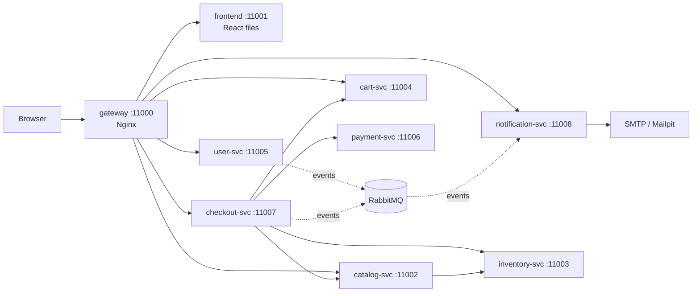

# Application guide

A map of the Catalogix application for someone who runs and deploys it rather than writes it. It answers three questions: what runs, how a request travels through it, and what breaks when a piece goes down.

The platform around the app (Terraform, Jenkins, Helm, monitoring) is described in the main [README](../README.md).

---

## 1. The big picture

Catalogix is a small online shop. Seven backend services each own one job and one database. The browser only ever talks to the gateway.

Solid arrows are synchronous HTTP calls. Dotted arrows are messages through RabbitMQ.

`inventory-svc` and `payment-svc` are internal only. The gateway has no route to them, so a browser can never reach them.

## 2. The services at a glance

| Service | Owns | Database | Port | Uses RabbitMQ |
|---|---|---|---|---|
| user-svc | accounts, login, sessions, addresses, roles | `catalogix-users` | 11005 | publishes |
| catalog-svc | products, search, seller ownership, moderation | `catalogix-catalog` | 11002 | no |
| inventory-svc | stock counts (the only place stock changes) | `catalogix-inventory` | 11003 | no |
| cart-svc | each user's cart | `catalogix-cart` | 11004 | no |
| payment-svc | mock payments (CARD, UPI, COD) and refunds | `catalogix-payment` | 11006 | no |
| checkout-svc | orders and the order state machine | `catalogix-checkout` | 11007 | publishes |
| notification-svc | sends emails, keeps a log | `catalogix-notification` | 11008 | consumes |
| security-common | shared library, not a service: JWT checks, rate limit, CORS | none | none | none |

Every backend service exposes `/health`, the Spring Boot Actuator health endpoints (Kubernetes probes use `/actuator/health`, `/actuator/health/readiness` and `/actuator/health/liveness`) and `/actuator/prometheus`. These need no token and are reachable only from inside the cluster, where the NetworkPolicy limits who can connect (see [the chart README](../infra/helm/catalogix-hc/README.md#networkpolicy)). Everything else needs a valid token.

## 3. The shape of every service

All seven services use the same folders, so once you understand one you understand all of them. They live in `app/backend/<service>/src/main/java/com/catalogix/<name>/`.

| Folder | What it holds |
|---|---|
| `controller/` | The HTTP endpoints. It receives a request, checks who is calling, and passes it to the service class. |
| `svc/` | The business logic. This is the file to read when you want to know what the service really does. |
| `repository/` | Database access. Each interface maps to a table. |
| `model/` | The database entities (one class per table). |
| `dto/` | The request and response shapes sent over HTTP. |
| `client/` | Code that calls other services over HTTP, with timeouts and circuit breakers. |
| `config/` | Wiring: RabbitMQ, caching, seed data, API docs. |
| `exception/` | Errors and how they become HTTP status codes. |
| `event/` | Message shapes sent through RabbitMQ. |

The database schema lives in `src/main/resources/db/migration/*.sql` (Flyway). Settings live in `src/main/resources/application.properties`. Secrets and URLs come in as environment variables.

## 4. Follow one order from click to email

This is the most important flow, and the one worth being able to tell out loud.

1. **Browser to gateway.** The browser calls `POST /api/orders/checkout` with an `Idempotency-Key` header. Nginx strips `/api` and forwards it to checkout-svc.
2. **Token check.** `JwtAuthFilter` (in `security-common`) verifies the user's token. A bad or missing token gets a 401.
3. **Cart.** checkout-svc asks cart-svc for the user's cart.
4. **Price and stock.** For each item, checkout-svc reads the price from catalog-svc (never from the browser) and reserves stock in inventory-svc.
5. **Save the order.** checkout-svc fetches the shipping address from user-svc and saves the order as `PENDING_PAYMENT`. The cart is cleared.
6. **Pay.** The browser calls `POST /api/orders/{id}/pay`. The order moves to `PAYMENT_PROCESSING` so a second click is rejected, then checkout-svc calls payment-svc.
7. **Result.**
   - Success: the order becomes `CONFIRMED`.
   - Declined: the order becomes `CANCELLED` and the reserved stock is released.
   - Unknown (a timeout): the order returns to `PENDING_PAYMENT` and the customer can retry safely with the same key.
8. **Email.** On `CONFIRMED` or `CANCELLED`, an event row is written to the `order_event_outbox` table in the same database transaction. A background job then sends it to RabbitMQ. notification-svc consumes it, sends the email, and records the result in `notification_log`.

Order states: `PENDING_PAYMENT` → `PAYMENT_PROCESSING` → `CONFIRMED` → `SHIPPED` → `DELIVERED`. `CANCELLED` is reachable from `PENDING_PAYMENT` or `CONFIRMED`.

## 5. Four ideas, in plain words

| Idea | What it means | Where to see it |
|---|---|---|
| **Idempotency key** | A unique id sent with a request. If the same request arrives twice (a retry or a double click), the server returns the first result and does the work only once. | `Idempotency-Key` header; `existingOrder` in `CheckoutSvc`; `InventorySvc.adjust` |
| **Compensation (saga)** | There is no single database transaction across services, so each step has an "undo" step. If payment fails, the stock reservation is released. | `CheckoutSvc.placeOrder` and `compensate` |
| **Outbox** | Instead of calling an unreliable system directly, write the job into a table in the same transaction, and let a background job retry until it works. | `compensation_outbox` and `order_event_outbox` tables; `*OutboxProcessor` classes |
| **Service tokens** | When one service calls another with no user involved, it signs a token that lives for 2 minutes with one internal key pair that all services share. The receiver checks the signature, that the token is addressed to it, and, on payment-svc, inventory-svc and the notification-preferences endpoint of user-svc, that the calling service named in the token is on its allowlist. Because the key is shared, the calling-service name is a sanity check, not proof: any service that holds the key could claim another name. | `JwtService`, and the `serviceId` checks in `PaymentController` and `InventoryController` |

## 6. What happens when something is down

This comes from reading the code, not from a test run. Confirm each row yourself by stopping that component in a test environment.

| If this is down | What you should see |
|---|---|
| payment-svc | Paying fails, the order goes back to `PENDING_PAYMENT`, and a retry with the same key works. |
| inventory-svc | Placing an order fails. Stock releases that could not be sent are queued in `compensation_outbox` and retried. |
| RabbitMQ | Orders still confirm. Emails wait as `PENDING` rows in `order_event_outbox` and go out when it returns. |
| notification-svc | Messages wait in their RabbitMQ queues. Nothing is lost. |
| PostgreSQL | Every service reports unhealthy. |
| One checkout-svc pod | Other replicas keep working. The outbox jobs use `FOR UPDATE SKIP LOCKED`, so replicas never process the same row. |

Rows that fail repeatedly end in `DEAD_LETTER`. Compensation dead letters can be retried in the admin screen (`/admin/outbox`), and a Prometheus alert fires for both outbox tables.

## 7. Where to look first

Read these in order. Each one builds on the previous one.

1. `docker-compose.yaml`: every service, its port and the environment variables it needs.
2. `app/gateway/nginx.conf`: which URL goes to which service, and the rate limits.
3. `app/backend/catalog-svc/.../controller/ProductController.java` and `svc/ProductSvc.java`: the simplest full example of controller to service to database.
4. `app/backend/inventory-svc/.../svc/InventorySvc.java`: a small class that shows idempotency and row locking.
5. `app/backend/checkout-svc/.../svc/CheckoutSvc.java`: the order flow from section 4. Read `placeOrder` and `payOrderInternal` first.
6. `app/backend/checkout-svc/.../svc/CompensationOutboxProcessor.java` and `OrderEventOutboxProcessor.java`: the retry jobs.
7. `app/backend/security-common/.../JwtAuthFilter.java` and `JwtService.java`: how every request is authenticated.
8. `app/frontend/src/App.jsx` and `app/frontend/src/api/client.js` and `app/frontend/src/api/index.js`: the pages, and how the browser attaches and refreshes the token.

## 8. Roles

| Role | Can do |
|---|---|
| customer (`USER`) | Browse, use the cart, order, manage their own account |
| `SELLER` | Everything a customer can, plus create and manage their own products. Granted by an admin after a request. |
| `ADMIN` | Moderate products, manage users and roles, and see and retry dead-letter outbox entries |

Registration only creates customers. Only an admin can grant `SELLER` or `ADMIN`.

## 9. Frontend pages

The React app has one page per component in `app/frontend/src/components/`. Routes are in `app/frontend/src/App.jsx`: products, cart, orders and account for everyone who is logged in, `my-products` for sellers, and `users`, `admin/moderation`, `admin/outbox` and `notifications` (the email log) for admins only. The login, password reset and email verification pages work without a token.

The look is Tailwind CSS plus a few small Radix components (dialog, menu) in `app/frontend/src/components/ui/`. Colours and fonts are defined once, as variables at the top of `app/frontend/src/index.css`, and dark mode follows the browser setting. It still builds to plain static files, so the Dockerfile, Helm chart and gateway are unchanged.
