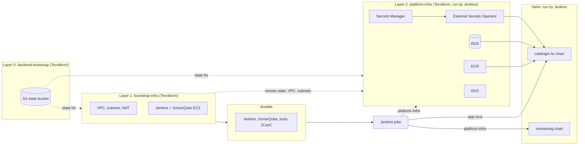

# infra/

Everything that decides where Catalogix runs and how it gets there. The application itself is in [`../app`](../app/README.md).

```text
infra/
  terraform/   AWS resources in three independent roots      -> terraform/README.md
  ansible/     configures the Jenkins and SonarQube servers   -> ansible/README.md
  jenkins/     the Jenkinsfiles (pipelines as code)           -> jenkins/README.md
  helm/
    catalogix-hc/   the application chart                      -> helm/catalogix-hc/README.md
    monitoring/     Prometheus, Grafana, alerts                -> helm/monitoring/README.md
```

The scripts that drive these tools from a laptop or VM are in [`../scripts`](../scripts/README.md).

## How the pieces connect



| Layer | Created by | Lifetime |
|---|---|---|
| State bucket | `terraform/backend-bootstrap` | Once per AWS account and region. Never destroyed by the scripts |
| Network and CI servers | `terraform/bootstrap-infra` | Applied once and left running |
| Server configuration | `ansible` | Re-run whenever the Jenkins or SonarQube setup changes |
| Platform | `terraform/platform-infra/env/<env>`, applied by the `platform-infra` Jenkins job | Created and destroyed freely |
| Monitoring | `helm/monitoring`, installed by the `platform-infra` job | With the cluster |
| Application | `helm/catalogix-hc`, installed by the `app-cicd` job | Every deploy |

## Order of operations

1. **Tools and credentials on your machine.** `bash scripts/bash/install-all.sh`, `aws configure`, `bash scripts/bash/create-key-pair.sh`.
2. **Bootstrap.** `python3 scripts/python/bootstrap.py` runs, in order: state bucket, network and servers (plus waiting for the EC2 status checks), Ansible, and the operator credentials prompt. Each step can also be run alone: `backend`, `infra`, `ansible`, `credentials`.
3. **Platform.** In Jenkins run `platform-infra` with `ACTION=Apply` and the chosen `ENV`. It needs the operator credentials secret to be complete and refuses to start otherwise.
4. **Application.** Run `app-cicd` (or push to `main`, see [../docs/github-webhook.md](../docs/github-webhook.md)).

Tear-down is the reverse: `platform-infra` with `ACTION=Destroy` and `CONFIRM_DESTROY=true`, then `python3 scripts/python/destroy_infra.py`. The platform must go first because the network layer cannot be deleted while the cluster's load balancers and network interfaces still exist.

## Secrets: who creates what

| Secret in AWS Secrets Manager | Created by | Read by |
|---|---|---|
| `<cluster>/operator-credentials` | `python3 scripts/python/bootstrap.py credentials` (you choose the values) | Terraform (RDS master password, optional read-only login), External Secrets (RabbitMQ and admin password into `catalogix-secrets`; Grafana login into `grafana-admin-secret`) |
| `<cluster>/db-credentials` | Terraform | Holds the RDS master login. No template reads it |
| `<cluster>/app-secrets` | Terraform (`db_user_<svc>` and `db_password_<svc>` for each service) | External Secrets, into the `catalogix-secrets` Kubernetes Secret |
| `<cluster>/jwt-keys` | Terraform (`tls_private_key`) | External Secrets, into the `catalogix-jwt-keys` Kubernetes Secret |
| `<cluster>/alerting-secrets` | Terraform (`smtp_password`) | External Secrets, into `alertmanager-secrets` in the `monitoring` namespace |

`<cluster>` is `catalogix-cluster-dev` for `ENV=dev` and `catalogix-cluster-<env>` otherwise. The JWT secret holds four keys: `jwt_private_key_b64`, `jwt_public_key_b64` (the user access-token pair) and `internal_jwt_private_key_b64`, `internal_jwt_public_key_b64` (the one internal pair shared by all services). External Secrets refreshes every hour, and pods read secrets as environment variables at start, so a changed value needs a pod restart.

## Operator access (IP allowlist)

SSH (22) and the Jenkins UI (8080) accept connections only from IPs on an allowlist, and the same list is added to the EKS public API endpoint. The list is **additive**:

- `scripts/python/allowlist.py` stores it in the state bucket (`access/allowed-cidrs.json`). Every `python3 scripts/python/bootstrap.py infra` run adds the IP you are connecting from if it is new. Nothing is removed automatically, so an ISP change or a second operator never locks out the earlier IPs.
- Terraform receives the list through `allowed_cidrs.auto.tfvars.json` (git-ignored) and creates one security group rule per CIDR, so adding an IP never replaces the existing rules.
- The list is deleted with the deployment by `destroy_infra.py`.

```bash
python3 scripts/python/allowlist.py list
python3 scripts/python/allowlist.py add 203.0.113.7/32 --label office
python3 scripts/python/allowlist.py remove 203.0.113.7/32
python3 scripts/python/allowlist.py prune --older-than 30        # drop entries not seen for 30 days (never your own IP)
python3 scripts/python/allowlist.py prune --all-but-current
python3 scripts/python/bootstrap.py infra                         # apply the change to the security groups
```

After a change, run `platform-infra` (Apply) again so the EKS API list is updated too. Every stale IP is a hole, so prune now and then. EKS accepts at most 40 allowed ranges including Jenkins' own.

## Changing the region, cluster or bucket name

`ap-south-1`, `catalogix-cluster-<env>` and the state bucket name `catalogix-tfstate` appear in several places because Terraform backends cannot use variables. The full list is in [terraform/README.md](terraform/README.md#state-bucket-name). The pipelines set `AWS_REGION` and `CLUSTER_NAME` at the top of `Jenkinsfile.app-cicd` and `Jenkinsfile.platform-infra`, and the dynamic inventory in `ansible/aws_ec2.yaml` lists the region.
